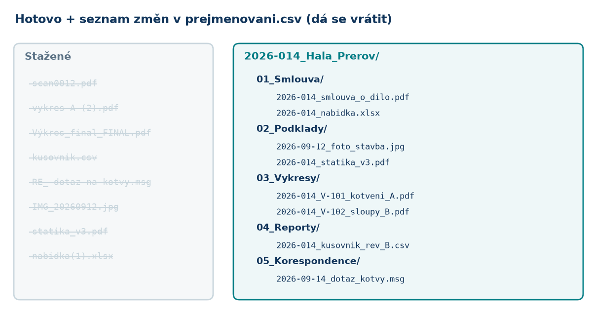
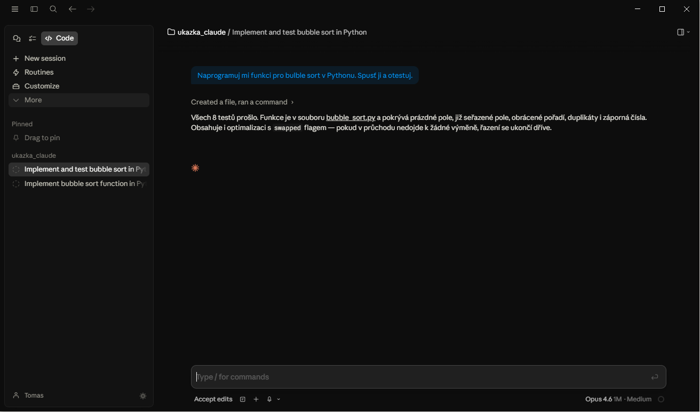
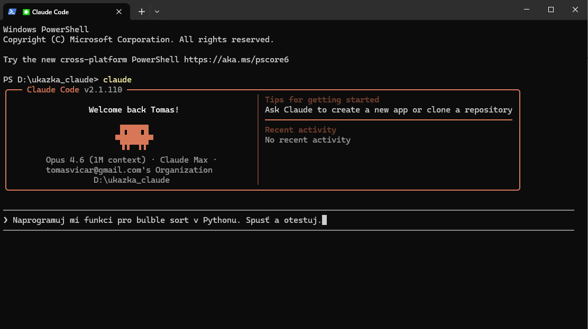
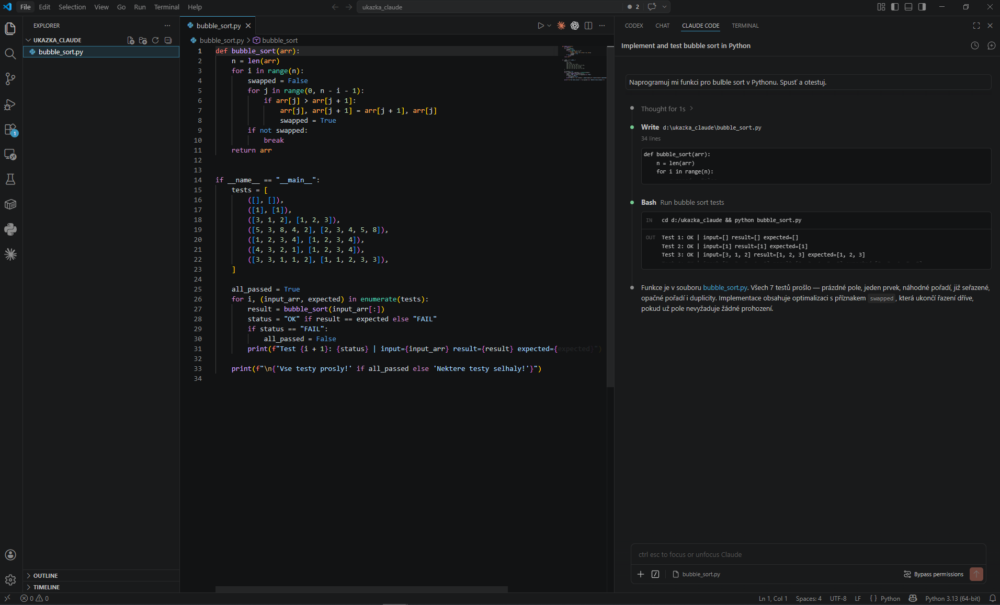
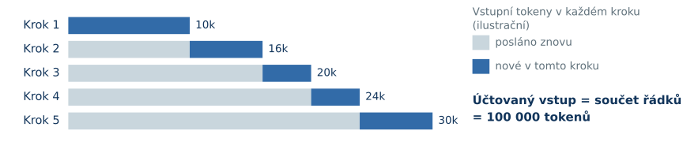

## Dnešní plán

::: columns
:::: {.column width="58%"}
1. **Co je AI agent** a čím se liší od chatbota
2. **Claude Desktop**: instalace, první spuštění, oprávnění
3. **Kancelář**: složky zakázky, soubory, PDF, Excel, dopisy
4. **Data z Tekly**: report → Excel, hmotnosti, nabídka, revize
5. **Živá Tekla**: makra a MCP, nejdřív jen čtení
6. **Prakticky**: cena, limity, soukromí, NDA, licence
::::
:::: {.column width="42%"}
{width=100%}
::::
:::

# Co je AI agent {.section-illus background-image="figures/illus_section_harness.png" background-size="44%" background-position="96% 55%" background-color="#f7fbff"}

Zadáte úkol. Agent použije nástroje. Vy zkontrolujete výsledek.

## Jazykový model jen pokračuje v textu

::: columns
:::: {.column width="62%"}
::: {.nw}
<div class="nw-text"></div>
<div class="nw-bars"></div>
<button class="btn-w nw-greedy">nejpravděpodobnější</button><button class="btn-w nw-random">náhodně</button><button class="btn-w nw-reset">znovu</button>
:::
::::
:::: {.column width="38%"}
- Odhadne **pravděpodobnost dalšího slova**, jedno vybere, připíše a opakuje.
- **Klikněte na slovo** a sestavte větu.
- Výsledek je **věrohodný text**, ne posudek. Zkuste najít „unese 247 kN“.
::::
:::

::: {.small-note}
Hračka s vymyšlenými pravděpodobnostmi. Skutečný model počítá s celým textem, ne jen s posledním slovem. Statiku za vás nepočítá ani nepodepíše.
:::

## Od odpovědi k hotovému souboru

*„Z exportovaného kusovníku udělej přehled hmotností podle profilů do Excelu.“*

- **Odpověď v chatu:** postup nebo kód, který si máte spustit sami.
- **Agent s nástroji:** přečte report, napíše a spustí skript a uloží `hmotnosti.xlsx`.
- **Vy:** otevřete Excel a porovnáte součet s hmotností v Tekle.

::: {.insight-box}
I chat může mít nástroje. Rozhoduje, **co může udělat s vašimi soubory**.
:::

## Stejný úkol, dva způsoby práce

::: {.vs}
:::: {.bot}
[💬 Chat bez nástrojů]{.vs-h}

*„Sečti hmotnosti z kusovnik.csv“*

1. napíše vzorec nebo kód **jako text**
2. [vy]{.you} ho zkopírujete do Excelu
3. nesedí desetinná čárka → [vy]{.you} vložíte chybu zpět
4. nový návod → [vy]{.you} znovu zkoušíte…

Vidí jen to, co mu vložíte do chatu.
::::
:::: {.agent .fragment}
[🤖 Agent]{.vs-h}

*„Sečti hmotnosti z kusovnik.csv“*

1. **sám otevře** soubor ve složce zakázky
2. napíše skript a **spustí ho**
3. chyba → **sám ji opraví**
4. uloží `hmotnosti.xlsx` a řekne, co zkontroloval

Používá soubory a nástroje, ke kterým mu dáte přístup.
::::
:::

## Jak agent provede jeden krok

{width=100%}

- **Model** (v cloudu Anthropic) navrhne akci, například spuštění skriptu.
- **Aplikace** Claude Desktop ji na vašem počítači provede (pokud to povolíte) a vrátí výsledek.

## Smyčka na datech z Tekly

{width=92% fig-align="center"}

::: {.small-note}
Chyba je pro agenta informace, ne selhání. Ilustrační průběh s vymyšlenými čísly, ne záznam.
:::

## Stejně tak uklidí složku zakázky

{width=88% fig-align="center"}

::: {.small-note}
Nejdřív si nechte ukázat **plán přejmenování**, pak teprve přesouvat. Seznam změn umožní vše vrátit.
:::

## Živě: chatbot vs. agent

Stejné zadání, dvě záložky jedné aplikace:

```default
Z reporty/kusovnik_rev_B.csv udělej přehled hmotností
podle profilů a materiálů do Excelu. Uveď celkový součet.
```

::: columns
:::: {.column width="50%"}
**Claude Desktop → Chat**

poradí postup, případně vrátí soubor ke stažení
::::
:::: {.column width="50%"}
**Claude Desktop → Code**: agent

pracuje přímo ve složce zakázky a uloží hotový Excel
::::
:::

# Claude Desktop {.section-illus background-image="figures/illus_section_workplace.png" background-size="44%" background-position="96% 55%" background-color="#f7fbff"}

Kde agent běží, kdo ho provozuje a kdo platí.

## Co používáme

| Co | K čemu | U nás |
| --- | --- | --- |
| **Model** | navrhuje odpovědi a kroky | Claude (Sonnet, Opus) |
| **Provozovatel** | poskytuje model | Anthropic, předplatné **Pro** (nebo Team) |
| **Aplikace** | zadáváte v ní úkoly | **Claude Desktop**, záložka **Code** |
| **Počítač** | kde běží skripty a soubory | váš počítač s Windows (a Teklou) |

Píšete do aplikace, model v cloudu navrhuje další krok, váš počítač ho provede.

## Tři způsoby, jak Clauda spustit

::: {.three}
<div class="hl"><b>Aplikace</b>okno, výběr složky a chat<br><em>Dnes: Claude Desktop → Code.</em></div>
<div><b>Terminál</b>textové okno (PowerShell)<br><em>Stejný agent, jen bez oken.</em></div>
<div><b>Rozšíření v editoru</b>kód, soubory a chat vedle sebe<br><em>Až budete psát víc maker.</em></div>
:::

::: {.interface-slides}
<div><span>Aplikace</span></div>
<div><span>Terminál</span></div>
<div><span>Rozšíření</span></div>
:::

::: {.small-note}
Ilustrační snímky z [přehledu AI nástrojů](https://slytherins-hub.github.io/prg_exercises/cviceni_13_ai/09_slide_prehled/). Pro začátek stačí aplikace, terminál znát nemusíte.
:::

## Instalace krok za krokem

1. **Předplatné Claude Pro** na claude.ai (verze Free záložku Code nemá)
2. **Claude Desktop** z [claude.com/download](https://claude.com/download) a přihlásit se
3. **Git for Windows**: Claude pak umí ukázat a vrátit změny souborů
4. Nastavení → Soukromí: **vypnout „Model improvement“**
5. Záložka **Code** → vybrat složku → *„Ahoj, co je v této složce?“*

Python a jeho knihovny si Claude doinstaluje sám přes `uv`, až je bude potřebovat.

::: {.insight-box}
Podrobný návod: [**Instalace**](../instalace.qmd). Postupujeme společně.
:::

## Oprávnění: kolik toho smí sám

| Režim | Co dělá | Kdy |
| --- | --- | --- |
| **Plan** | jen čte a navrhne plán, nic nemění | větší úkol, nová věc |
| **Manual** (výchozí) | na každou změnu a příkaz se zeptá | **začátky** |
| **Accept edits** | soubory upravuje sám, příkazy schvalujete | ověřený postup |
| **Auto** / bez ptaní | rozhoduje sám | **zatím ne** |

- Když se Claude ptá, **přečtěte si, co chce provést**. „Ne“ je v pořádku.
- Na Windows neběží v izolovaném prostředí (sandbox): **ochranou jste vy a oprávnění**.

# Co jde udělat jen povídáním {.section-illus background-image="figures/illus_section_beyond.png" background-size="40%" background-position="96% 55%" background-color="#f7fbff"}

Kancelář, data z Tekly, živý model.

## Kancelář

::: {.cards .big}
<div><span class="ico">🗂️</span><b>Složka zakázky</b>založit strukturu podle vaší šablony</div>
<div><span class="ico">🏷️</span><b>Přejmenování</b>stovky souborů podle jednotného klíče</div>
<div><span class="ico">📑</span><b>PDF výkresy</b>spojit, rozdělit, seřadit, očíslovat</div>
<div><span class="ico">📋</span><b>Předávací protokol</b>seznam výkresů s revizemi z PDF</div>
<div><span class="ico">📈</span><b>Excel</b>vzorce, souhrny, kontingenční přehledy, grafy</div>
<div><span class="ico">✉️</span><b>Dopisy a e-maily</b>dotaz na statika, průvodní dopis, upomínka</div>
<div><span class="ico">📝</span><b>Word</b>technická zpráva, sjednocení formátu</div>
<div><span class="ico">📷</span><b>Fotky ze stavby</b>seřadit podle data, zmenšit, popsat</div>
:::

[Kancelářská cvičení →](../kancelar.qmd)

## Data z Tekly, bez rizika pro model

::: {.cards .big}
<div><span class="ico">📊</span><b>Report → Excel</b>exportovaný kusovník jako přehledná tabulka</div>
<div><span class="ico">⚖️</span><b>Hmotnosti</b>podle fází, profilů, materiálů a dílců</div>
<div><span class="ico">💰</span><b>Nabídka</b>hmotnosti × vaše ceny za kg, nátěr, montáž</div>
<div><span class="ico">🔀</span><b>Porovnání revizí</b>co přibylo, ubylo, změnilo se (rev A vs B)</div>
<div><span class="ico">🔎</span><b>Kontrola reportu</b>prázdné UDA, chybí materiál, „?“ v číslování</div>
<div><span class="ico">⚙️</span><b>NC / DSTV</b>sedí složka NC souborů s kusovníkem?</div>
<div><span class="ico">🧱</span><b>IFC</b>spočítat prvky, zkontrolovat vlastnosti</div>
<div><span class="ico">📄</span><b>Souhrn do PDF</b>přehled pro investora nebo dílnu</div>
:::

Pracuje se **s exportovanými soubory**: model v Tekle se nemůže poškodit. [Cvičení s daty z Tekly →](../cviceni.qmd)

## Živá Tekla a další

::: {.cards .big}
<div><span class="ico">🧩</span><b>C# makro</b>Claude ho napíše, vy spustíte v Tekle</div>
<div><span class="ico">👀</span><b>Čtení modelu</b>vypiš vybrané díly a jejich atributy</div>
<div><span class="ico">✏️</span><b>Hromadné změny</b>class, prefix, UDA, nejdřív na kopii modelu</div>
<div><span class="ico">🔌</span><b>MCP</b>ptát se otevřeného modelu přímo z chatu</div>
<div><span class="ico">🧊</span><b>3D model</b>detail, kotvení nebo přípravek k vytištění</div>
<div><span class="ico">🌐</span><b>Webová stránka</b>přehled zakázky, reference, ceník</div>
<div><span class="ico">🎞️</span><b>Prezentace</b>i tahle; jako web nebo PDF</div>
<div><span class="ico">🧮</span><b>Malé nástroje</b>kalkulačka nátěru, převod profilů, šablony</div>
:::

[Živá Tekla →](../tekla.qmd) · [Galerie ukázek →](../ukazky.qmd)

## Markdown: text s jednoduchým formátováním

::: {.live-label}
<span>**Markdown** (`.md`): obyčejný text, `#` = nadpis, `-` = odrážka, `**tučně**`. Zkuste psát ↓</span><span>Jak to vypadá</span>
:::

::: {.live .live-md}
<textarea spellcheck="false"># Zakázka 2026-014: Hala Přerov

Ocelová hala **24 × 48 m**, Tekla 2025.

## Pravidla
- reporty jsou ve složce `reporty/`
- hmotnosti uváděj v **tunách**
- model v Tekle **neměň**
- [ ] doplnit ceník nátěru

| fáze | hmotnost (t) |
|---|---|
| 1 sloupy | 9,8 |
| 2 vazníky | 18,4 |
</textarea>
<div class="live-out"></div>
:::

::: {.small-note}
V Markdownu Claude píše poznámky, plány a hlavně pravidla projektu (`CLAUDE.md`). Čte se dobře jako text i jako stránka.
:::

## HTML: jazyk webových stránek

::: {.live-label}
<span>**HTML** (`.html`): text se značkami `<h1>`, `<p>`, `<button>`. Otevře ho každý prohlížeč. Zkuste upravit ↓</span><span>Jak to vypadá</span>
:::

::: {.live .live-html}
<textarea spellcheck="false"><h1 style="color:#12355b">Hala Přerov</h1>
<p>Ocelová konstrukce, celkem <b>28,2 t</b>.</p>
<ul>
  <li>fáze 1, sloupy: 9,8 t</li>
  <li>fáze 2, vazníky: 18,4 t</li>
</ul>
<button onclick="this.textContent='Odesláno ✔'"
  style="font-size:20px;margin-top:12px">
  Schválit nabídku
</button>
</textarea>
<iframe title="Náhled HTML"></iframe>
:::

::: {.small-note}
Proto Claude rád dělá HTML: přehled zakázky s tabulkou i grafem pošlete e-mailem jako jeden soubor.
:::

## Jak zadávat

::: columns
:::: {.column width="60%"}
- **Popište výsledek, ne postup.** A podle čeho poznáte, že je hotovo.
- Řekněte **z čeho vycházet a kam výsledek uložit**.
- Odkazujte na **soubory**, nekopírujte data do chatu.
- Trvalá pravidla patří do **`CLAUDE.md`**, ne jen do chatu.

```default
Porovnej reporty/kusovnik_rev_A.csv a _rev_B.csv.
Do Excelu dej listy Přibylo, Ubylo, Změněno.
Na závěr ověř, že rozdíl hmotností sedí na součty.
```
::::
:::: {.column width="40%"}
{width=100%}

::: {.small-note}
Agent vidí jen to, co leží „na stole“: zadání a soubory, které si přečetl. Ne celý disk ani celý model.
:::
::::
:::

## Kontrolujte

::: columns
:::: {.column width="60%"}
**Viditelná chyba:** skript spadne, Excel je prázdný → popíšete, co opravit.

**Věrohodné, ale špatně:** zapomenutý plech, hmotnost v kg místo t, prohozené revize → **nic se nerozbije, jen to nesedí**.

::: {.insight-box}
Za výsledek zodpovídáte vy. Porovnejte součet s Teklou, přepočítejte jeden řádek ručně, zeptejte se „proč?“.
:::

Claude **nezná spolehlivě ČSN/EN** a nic neposuzuje. Výsledek musí ověřit kvalifikovaná osoba.
::::
:::: {.column width="40%"}
{width=100%}
::::
:::

# Pravidla a bezpečnost {.section-illus background-image="figures/illus_section_recoverable.png" background-size="34%" background-position="92% 55%" background-color="#f7fbff"}

CLAUDE.md, skills, oprávnění, zálohy.

## CLAUDE.md: trvalá pravidla projektu

::: columns
:::: {.column width="55%"}
Soubor ve složce projektu. Claude si ho **přečte na začátku každé konverzace**.

- verze Tekly a prostředí (CZ), cesty ke složkám
- „**neprogramuji**, vysvětluj česky a krok za krokem“
- vaše profily, materiály, UDA, číslování
- „model měň **jen v kopii a po potvrzení**“

*„Zapiš si to do CLAUDE.md.“* stačí říct.
::::
:::: {.column width="45%"}
```markdown
# Tekla projekty

- Tekla Structures 2025, CZ prostředí
- Reporty: reporty/*.csv, oddělovač ;
- Desetinná čárka, hmotnosti v t
- Uživatel neprogramuje: vysvětluj
  česky, krok za krokem
- Model NIKDY neměň bez potvrzení
- Používej jen ověřené metody
  Tekla Open API (reference/)
```
::::
:::

::: {.small-note}
Pravidla Clauda **žádají**, ale nenutí. Opravdu omezit ho můžete jen **oprávněními**.
:::

## Skills: recept na opakovaný postup

::: columns
:::: {.column width="60%"}
- Skill = **návod ve složce**, který si Claude načte, když se hodí.
- Typicky: *nabídka z kusovníku*, *kontrola reportu*, *předávací protokol*.
- Vznikne z hotové práce:

```default
Z toho, co jsme právě udělali, udělej skill
„nabidka-z-kusovniku“. Ceny ber z cenik.xlsx.
```

- Příště stačí: *„Udělej nabídku pro zakázku 2026-017.“*
::::
:::: {.column width="40%"}
{width=100%}

::: {.small-note}
Trimble má v Model Assistantovi stejný nápad: soubory `rules.md` a `skills.md`.
:::
::::
:::

## Zálohy dřív, než začnete

::: columns
:::: {.column width="50%"}
**Soubory**

- Pracujte **v kopii** složky nebo s **Gitem**.
- Claude umí vrátit **své úpravy souborů**.
- Originály exportů nechte netknuté.
::::
:::: {.column width="50%"}
**Model v Tekle**

- Před každou AI session: *File → Save as → **Save and create backup copy*** (zachová GUID).
- Zkoušejte na **kopii modelu**, nikdy na sdíleném masteru.
- Každá změna z makra = **jeden krok Undo**. Undo není záloha.
- Změny přes MCP **Claude sám nevrátí**.
::::
:::

::: {.insight-box}
Pořadí: **jen číst → změna na kopii → teprve pak ostrý model**, a vždy se zálohou.
:::

## Git: historie složky, ke které se dá vrátit

{width=100%}

Příkazy znát nemusíte, stačí říct:
*„Ulož aktuální stav do gitu.“* · *„Co se změnilo?“* · *„Vrať se k poslední funkční verzi.“*

# Claude a Tekla {.section-illus background-image="figures/illus_section_reach.png" background-size="40%" background-position="96% 55%" background-color="#f7fbff"}

Tři cesty: soubory, makra, MCP.

## Tři cesty, jak propojit Claude s Teklou

| Cesta | Jak to funguje | Riziko pro model | Kdy |
| --- | --- | --- | --- |
| **A. Soubory** | export reportu, IFC, PDF, NC → Claude zpracuje → Excel/PDF | **žádné** | **hned** |
| **B. C# makra** | Claude napíše makro do `macros\modeling`, vy ho spustíte v Tekle | střední: Undo, kopie | druhý krok |
| **C. MCP** | Claude se ptá otevřené Tekly přímo z chatu | podle nastavení | po otestování, **jen čtení** |

::: {.insight-box}
Nejvíc práce ušetří obvykle cesta **A**. Tekla sama třeba neporovná dvě revize kusovníku; skript ano.
:::

## Cesta B: makro, které napíše Claude

1. *„Napiš makro, které vypíše vybrané díly: pozice, profil, materiál, délka. **Nic neměň.**“*
2. Claude uloží `VypisDilu.cs` do složky maker.
3. V Tekle: **Applications & components → Macros** → spustit.
4. Chyba? Zkopírujte hlášku zpět Claudovi, opraví ji.
5. Až čtení funguje: změny (UDA, class, prefix) **na kopii modelu, s náhledem**.

::: {.small-note}
Makra pro vlastní potřebu licence Tekly dovoluje. Prodávat nebo předávat je klientům lze jen přes Tekla Partners Program. [Návod k makrům →](../tekla.qmd)
:::

## Cesta C: co je MCP

{width=100%}

**MCP** = „USB pro nástroje“: jednotný způsob, jak k Claudovi připojit program. Tady Teklu.

## MCP v praxi

- **Oficiální MCP od Trimble pro Teklu neexistuje.** Jsou komunitní servery.
- Favorit: [`tempalg1n/tekla-mcp-server`](https://github.com/tempalg1n/tekla-mcp-server): režim **jen pro čtení**, zápis s náhledem a potvrzením, umí běžet i bez Tekly.
- Zapojení: *Settings → Developer → Edit Config* v Claude Desktop, pak aplikaci úplně ukončit a spustit.
- Zápisové nástroje nastavte na **„ask“**, ať se Claude vždy zeptá.

::: {.insight-box}
MCP server je **cizí program** s přístupem k modelu. Jen ověřený, nejdřív na kopii modelu, nejdřív jen čtení.
:::

## A co Trimble? Vlastní AI přímo v Tekle

::: columns
:::: {.column width="55%"}
- **Tekla Model Assistant** (preview): agent v bočním panelu, čte výběr, vytváří a mění díly, spouští reporty.
- **Developer Assistant**: píše makra, model nevidí.
- **User Assistant**: odpovídá z nápovědy Tekly.
- Jen pro licence **Diamond / Graphite / Carbon**.
::::
:::: {.column width="45%"}
| | Model Assistant | Claude |
| --- | --- | --- |
| uvnitř Tekly | ano | přes makra / MCP |
| kancelář, Excel, PDF | ne | **ano** |
| licence | dražší Tekla | předplatné Claude |
::::
:::

::: {.small-note}
Mají se doplňovat, ne soupeřit. Jakou licenci máte, rozhodne, co z Trimble AI uvidíte.
:::

# Prakticky {.section-illus background-image="figures/illus_section_tips.png" background-size="38%" background-position="94% 55%" background-color="#f7fbff"}

Cena, limity, soukromí, NDA, licence.

## Kolik to stojí

| Tarif | Cena (bez DPH) | Pro koho |
| --- | --- | --- |
| **Free** | 0 | jen chat, **bez záložky Code** |
| **Pro** | 20 $ / měs. (17 $ při ročním) | **začátek**, jeden člověk |
| **Max** | 100–200 $ / měs. | když Pro pořád nestačí |
| **Team** | 25 $ / uživatel / měs. (20 $ ročně) | firma, **obchodní podmínky** |

**Limity:** chat i Code čerpají ze **stejného limitu**, který se obnovuje po několika hodinách, a k tomu je týdenní strop.
Dlouhé konverzace a velké soubory ho spotřebují rychleji.

::: {.small-note}
Ceny podle claude.com/pricing (říjen 2026), mohou se lišit podle regionu.
:::

## Další krok potřebuje i dosavadní kontext

{width=100%}

**Token** je kousek textu, třeba část slova. V každém kroku se modelu posílá celá dosavadní konverzace.

## Proč delší úkol spotřebuje víc

::: {.tk}
<label>Počet kroků agenta <input class="tk-turns" type="range" min="1" max="40" value="5"><b class="tk-turns-v"></b></label>
<label>Nový text v každém kroku <input class="tk-per" type="range" min="1" max="30" value="7"><b class="tk-per-v"></b></label>
<label>Počet úkolů <input class="tk-runs" type="range" min="1" max="200" value="1"><b class="tk-runs-v"></b></label>
<div class="tk-out"></div>
:::

::: {.small-note}
Ilustrační výpočet „kdybyste platili za tokeny“ (API): bez cache a zkracování historie, výstup 2 000 tokenů na krok, ukázkové sazby za milion vstupních/výstupních tokenů.
S předplatným Pro neplatíte za tokeny, ale **stejně rychle tím čerpáte limit**. Celý kusovník vložený do chatu = hodně tokenů.
:::

## Kontext se plní

::: columns
:::: {.column width="55%"}
{width=100%}
::::
:::: {.column width="45%"}
- Model najednou „vidí“ jen omezené množství textu.
- **Dlouhá konverzace ≠ lepší výsledek.** Zapomíná a opakuje chyby.
- Důležité ať zapíše do souboru (`CLAUDE.md`), pak **nová konverzace**.
- Po dvou neúspěšných opravách: nová konverzace a lepší zadání.
::::
:::

## Soukromí: co odchází do cloudu

- Vše, co Claude **přečte**, se posílá Anthropicu: zadání, obsah souborů, výsledky z MCP.
- **Pro:** vypnout *Model improvement* (pak se nepoužije k trénování, smaže se do 30 dnů).
- **Team:** obchodní podmínky, data se k trénování **nepoužívají**, smlouva o zpracování (DPA).
- Posílejte **co nejméně**: souhrny místo celého modelu, žádná jména a smlouvy, když nejsou potřeba.
- Text v cizích modelech a IFC berte jako **nedůvěryhodný**: může v něm být „pokyn“ pro AI.

## NDA a licence

::: columns
:::: {.column width="50%"}
**Klient a NDA**

- Smlouvy často zakazují předávat údaje o projektu třetím stranám. **AI služba může být třetí strana.**
- Přečtěte NDA; při pochybnosti **písemný souhlas** klienta.
- Pro jde v práci používat, ale bez DPA (GDPR) a s rizikem na straně uživatele; čisté papíry pro firmu o 2 lidech: **Team** (od 2 míst).
::::
:::: {.column width="50%"}
**Licence Tekly**

- Makra a nástroje **pro sebe**: v pořádku.
- **Předávat nebo prodávat** je: jen přes Tekla Partners Program.
- Výsledky musí ověřit **kvalifikovaná osoba** (EULA, čl. 9.2).
- Riziko vlastních aplikací nese uživatel.
::::
:::

::: {.small-note}
Nejde o právní radu. Výklad podmínek si ověřte u právníka nebo pojišťovny.
:::

## Kde se učit dál

::: columns
:::: {.column width="55%"}
- **Web tohoto workshopu**: návody, cvičení, `CLAUDE.md` ke stažení
- [Claude Code for Everyone](https://ccforeveryone.com/): kurz pro neprogramátory, přímo v Claudovi
- [Anthropic Academy](https://anthropic.skilljar.com/): oficiální kurzy zdarma
- [Dokumentace Claude Code](https://code.claude.com/docs/en/best-practices): osvědčené postupy
- **Construsoft CZ**: webinář *Automatizace a AI v Tekla Structures* (19. 11. 2026)
- [Tekla Warehouse](https://warehouse.tekla.com): spoustu věcí už někdo udělal
::::
:::: {.column width="45%"}
{width=100%}
::::
:::

## Pět zásad na cestu

1. **Popište výsledek**, ne postup. A podle čeho poznáte, že je hotovo.
2. **Odkazujte na soubory**, nekopírujte data do chatu.
3. **Kontrolujte**: součet proti Tekle, jeden řádek ručně, „proč?“.
4. **Nejdřív jen číst**, změny na kopii a se zálohou.
5. **Pravidla do `CLAUDE.md`**, citlivá data jen se souhlasem.

::: {.insight-box}
Claude píše a počítá, vy zadáváte a kontrolujete. Výsledek je váš, ať ho napsal kdokoli.
:::

# Díky! {.section-illus background-image="figures/illus_section_beyond.png" background-size="36%" background-position="92% 55%" background-color="#f7fbff"}

[Návody, cvičení a prezentace jsou na webu workshopu.](../index.qmd)

**Dotazy?**
