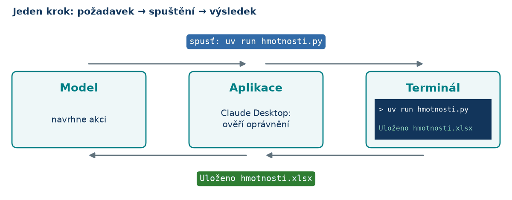
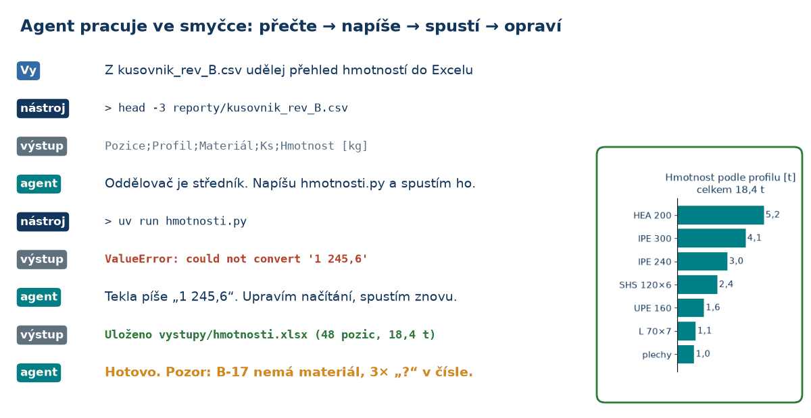
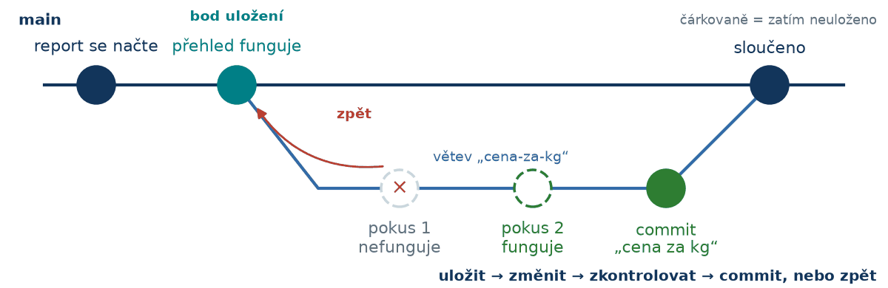
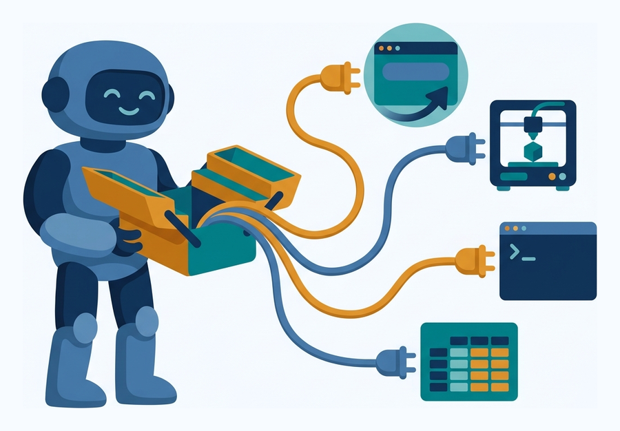
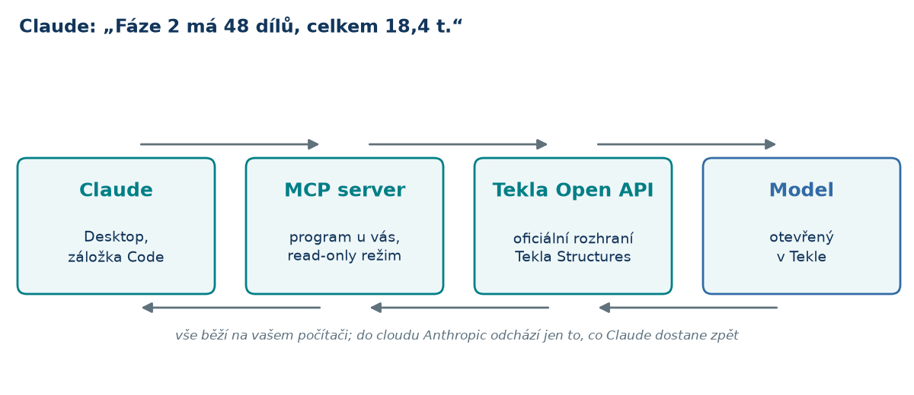
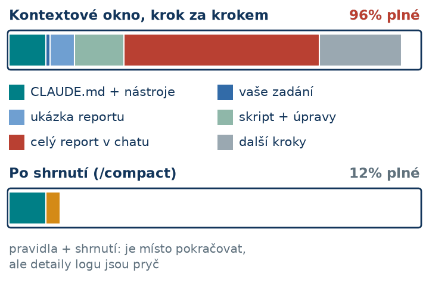

## Dnešní plán

::: columns
:::: {.column width="58%"}
1. **Co je AI agent** a čím se liší od chatbota
2. **Claude Desktop**: oprávnění, zálohy
3. **Co jde udělat**: kancelář, data z Tekly, jak zadávat
4. **Claude a Tekla**: 1 Soubory · 2 Makra · 3 MCP
5. **Prakticky**: cena, soukromí, limity
::::
:::: {.column width="42%"}
{width=100%}
::::
:::

# Co je AI agent {.section-illus background-image="figures/illus_section_harness.png" background-size="44%" background-position="96% 55%" background-color="#f7fbff"}

Zadáte úkol. Agent použije nástroje. Vy zkontrolujete výsledek.

## AI agent obyčejnými slovy

::: columns
:::: {.column width="60%"}
- **Chatbot** odpoví textem. Práci pak děláte vy.
- **Agent** odpoví **a práci udělá**. Umí:
  - **číst soubory** ve složce, kterou mu ukážete
  - **psát** nové soubory: Excel, PDF, text
  - **spouštět programy**, které si sám napíše
- Vy píšete česky a **schvalujete**. Programovat nemusíte.
::::
:::: {.column width="40%"}
{width=100%}
::::
:::

::: {.insight-box}
Jako šikovný kolega u vašeho počítače: rychlý, ale občas se splete. Proto kontrolujete.
:::

## Jazykový model jen pokračuje v textu

::: columns
:::: {.column width="62%"}
::: {.nw}
<div class="nw-text"></div>
<div class="nw-bars"></div>
<button class="btn-w nw-greedy">nejpravděpodobnější</button><button class="btn-w nw-random">náhodně</button><button class="btn-w nw-reset">znovu</button>
:::
::::
:::: {.column width="38%"}
- Odhadne **další slovo**, připíše ho a opakuje.
- **Klikněte na slovo** a sestavte větu.
- Výsledek je **věrohodný text**, ne posudek. Zkuste „unese 247 kN“.
::::
:::

::: {.small-note}
Hračka s vymyšlenými pravděpodobnostmi. Statiku za vás nepočítá ani nepodepíše.
:::

## Chatbot vs. agent: stejný úkol

::: {.vs}
:::: {.bot}
[💬 Chat bez nástrojů]{.vs-h}

*„Sečti hmotnosti z hala_revB_part_list.csv“*

1. napíše vzorec nebo kód **jako text**
2. [vy]{.you} ho zkopírujete do Excelu
3. chyba → [vy]{.you} ji vložíte zpět
4. nový návod → [vy]{.you} zkoušíte znovu…
::::
:::: {.agent .fragment}
[🤖 Agent (záložka Code)]{.vs-h}

*„Sečti hmotnosti z hala_revB_part_list.csv“*

1. **sám otevře** soubor ve složce zakázky
2. napíše skript a **spustí ho**
3. chyba → **sám ji opraví**
4. uloží `hmotnosti.xlsx` a řekne, co ověřil
::::
:::

::: {.insight-box}
Rozhoduje, **co může udělat s vašimi soubory**. Vy pak porovnáte součet s Teklou.
:::

## Jak agent provede jeden krok

{width=100%}

- **Model** (v cloudu Anthropic) navrhne akci.
- **Claude Desktop** ji na vašem počítači provede, pokud to povolíte.

## Smyčka na datech z Tekly

{width=92% fig-align="center"}

::: {.small-note}
Chyba je pro agenta informace, ne selhání. Ilustrační průběh, vymyšlená čísla.
:::

# Claude Desktop {.section-illus background-image="figures/illus_section_workplace.png" background-size="44%" background-position="96% 55%" background-color="#f7fbff"}

Aplikace na vašem počítači, model v cloudu.

## Oprávnění: kolik toho smí sám

| Režim | Co dělá | Na workshopu |
| --- | --- | --- |
| **Auto** | sám posoudí, co je bezpečné; u rizikových kroků se zeptá | **nechte, je výchozí** |
| **Manual** | ptá se na každý příkaz | moc otázek |
| **Plan** | jen čte a navrhne postup | větší úkoly |
| **Bypass permissions** | na nic se neptá | **nikdy** |

- Po výběru složky: „Trust this workspace?“ → **Trust workspace**.
- Soubor mimo složku: zeptá se. **Always allow** platí jen do zavření konverzace.
- Jistota = **kopie souborů, git a záloha modelu**.

## Bezpečně

::: columns
:::: {.column width="52%"}
- Pracujte **v kopii** složky nebo s **Gitem**.
- Model v Tekle: **Save and create backup copy** před každou prací s AI.
- Postup: **jen číst → kopie modelu → ostrý model**.
- **Ctrl+Z** vrátí změnu z makra, ale **záloha je jistota**.
- Text v cizích modelech a IFC je **nedůvěryhodný**.
::::
:::: {.column width="48%"}
{width=100%}

::: {.small-note}
Stačí říct: *„Ulož stav do gitu.“* · *„Vrať poslední funkční verzi.“*
:::
::::
:::

# Co jde udělat jen povídáním {.section-illus background-image="figures/illus_section_beyond.png" background-size="40%" background-position="96% 55%" background-color="#f7fbff"}

Kancelář, data z Tekly, jak zadávat.

## Kancelář

::: {.cards .big}
<div><span class="ico">🗂️</span><b>Složka zakázky</b>struktura podle šablony</div>
<div><span class="ico">🏷️</span><b>Přejmenování</b>stovky souborů jedním klíčem</div>
<div><span class="ico">📑</span><b>PDF výkresy</b>spojit, rozdělit, očíslovat</div>
<div><span class="ico">📋</span><b>Předávací protokol</b>seznam výkresů z PDF</div>
<div><span class="ico">📈</span><b>Excel</b>vzorce, souhrny, grafy</div>
<div><span class="ico">✉️</span><b>Dopisy a e-maily</b>dotaz na statika, upomínka</div>
<div><span class="ico">📷</span><b>Fotky ze stavby</b>seřadit, zmenšit, popsat</div>
<div><span class="ico">🌐</span><b>Web a nástroje</b>přehled zakázky, kalkulačka</div>
:::

[Kancelářská cvičení →](../kancelar.qmd) · [Galerie ukázek →](../ukazky.qmd)

## Data z Tekly, bez rizika pro model

::: {.cards .big}
<div><span class="ico">📊</span><b>Report → Excel</b>kusovník jako tabulka</div>
<div><span class="ico">⚖️</span><b>Hmotnosti</b>podle fází, profilů, materiálů</div>
<div><span class="ico">💰</span><b>Nabídka</b>hmotnosti × vaše ceny</div>
<div><span class="ico">🔀</span><b>Porovnání revizí</b>co přibylo, ubylo, změnilo se</div>
<div><span class="ico">🔎</span><b>Kontrola reportu</b>prázdné UDA, chybí materiál</div>
<div><span class="ico">⚙️</span><b>NC / DSTV</b>sedí s kusovníkem?</div>
<div><span class="ico">🧱</span><b>IFC</b>spočítat prvky, vlastnosti</div>
<div><span class="ico">📄</span><b>Souhrn do PDF</b>pro investora nebo dílnu</div>
:::

Pracuje se **s exportem**: model v Tekle se nepoškodí. [Cvičení →](../cviceni.qmd)

## Jak zadávat: pět zásad

::: columns
:::: {.column width="62%"}
1. **Popište výsledek**, ne postup. Řekněte, z čeho vycházet a kam uložit.
2. **Odkazujte na soubory**, nekopírujte data.
3. **Kontrolujte**: součet proti Tekle, jeden řádek ručně.
4. **Nejdřív jen číst**, změny na kopii a se zálohou.
5. **Pravidla do `CLAUDE.md`**, citlivá data jen se souhlasem.

```default
Porovnej podklady/hala_revA_part_list.csv a hala_revB_part_list.csv.
Do vystupy/porovnani.xlsx dej listy Přibylo, Ubylo, Změněno.
Ověř, že rozdíl hmotností sedí na součty.
```
::::
:::: {.column width="38%"}
{width=100%}

::: {.small-note}
Agent vidí jen to, co leží „na stole“: zadání a přečtené soubory.
:::
::::
:::

## Kontrolujte

::: columns
:::: {.column width="60%"}
- **Viditelná chyba:** skript spadne → popíšete, co opravit.
- **Věrohodné, ale špatně:** chybí plech, kg místo t → **nic se nerozbije, jen to nesedí**.
- Ověřte: součet proti Tekle, jeden řádek ručně, „proč?“.
- ČSN/EN **nezná spolehlivě**, nic neposuzuje.

::: {.insight-box}
Za výsledek zodpovídáte vy.
:::
::::
:::: {.column width="40%"}
{width=100%}
::::
:::

## CLAUDE.md: trvalá pravidla projektu

::: columns
:::: {.column width="52%"}
Claude si ho **přečte na začátku každé konverzace**.

- verze Tekly, cesty ke složkám
- „**neprogramuji**, vysvětluj česky“
- profily, materiály, UDA, číslování
- „model měň **jen v kopii**“

*„Zapiš si to do CLAUDE.md.“* stačí říct.
::::
:::: {.column width="48%"}
```markdown
# Tekla projekty

- Tekla Structures 2025, CZ
- Vstupy v podklady/, výsledky do vystupy/
- Exporty z Tekly: *.csv, oddělovač ;
- Desetinná čárka, hmotnosti v t
- Uživatel neprogramuje:
  vysvětluj krok za krokem
- Model NIKDY neměň bez potvrzení
```
::::
:::

::: {.small-note}
`CLAUDE.md` je **prosba, ne zámek**. Zámek jsou **oprávnění**.
:::

## Skills: recept na opakovaný postup

::: columns
:::: {.column width="60%"}
- Skill = **návod ve složce**, Claude si ho načte, když se hodí.
- Vznikne z hotové práce:

```default
Z toho, co jsme právě udělali, udělej skill
„nabidka-z-kusovniku“. Ceny ber z cenik.xlsx.
```

- Příště stačí: *„Udělej nabídku pro Z2026-021.“*
::::
:::: {.column width="40%"}
{width=100%}
::::
:::

# Claude a Tekla {.section-illus background-image="figures/illus_section_reach.png" background-size="40%" background-position="96% 55%" background-color="#f7fbff"}

Tři úrovně: 1 Soubory · 2 Makra · 3 MCP.

## Tři úrovně propojení s Teklou

| Úroveň | Jak to funguje | Riziko pro model | Kdy |
| --- | --- | --- | --- |
| **1 · Soubory** | Tekla uloží report → Claude z něj udělá Excel/PDF | **žádné** | **hned** |
| **2 · Makra** | makro = malý program pro Teklu; Claude ho napíše, vy spustíte | **střední**: kopie modelu | druhý krok |
| **3 · MCP** | propojení: Claude se ptá otevřené Tekly | **žádné** při čtení | **jen čtení** |

::: {.insight-box}
Nejvíc práce ušetří obvykle úroveň **1**. Tekla sama neporovná dvě revize kusovníku; skript ano.
:::

## Úroveň 2: makro, které napíše Claude

1. *„Napiš makro, které vypíše vybrané díly. **Nic neměň.**“*
2. Claude makro **sám zkontroluje** a uloží do složky maker Tekly.
3. V Tekle: panel **Applications & components** → **≡** → **Catalog management** → **Reload catalog**.
4. Makro najděte podle názvu a spusťte **dvojklikem**.
5. Chybové okno? **Win+Shift+S** (výřez obrazovky) → **Ctrl+V** do chatu s Claudem.

Změny modelu až **na kopii**. **Jedno Ctrl+Z** vrátí celou změnu z makra.

::: {.small-note}
Makra pro sebe licence Tekly dovoluje; prodávat je lze jen přes Tekla Partners Program. [Návod →](../tekla.qmd)
:::

## Úroveň 3: MCP

{width=68% fig-align="center"}

- **MCP** = propojení, přes které se Claude **ptá otevřené Tekly**. Používáme [`tekla-mcp-server`](https://github.com/tempalg1n/tekla-mcp-server).
- Pro začátek **jen čtení**: souhrn, hmotnosti. **Změny modelu dělejte makry.**
- Změny přes MCP: pro pokročilé, později.

::: {.small-note}
Trimble má vlastní **Tekla Model Assistant** (preview), jen pro licence Diamond / Graphite / Carbon.
:::

## Vyzkoušeno na Tekle 2026

| Úkol | Výsledek |
| --- | --- |
| Makro **„jednoduchá hala“** | ✅ 51 dílů: 20 sloupů HEA200, 31 nosníků IPE300 |
| Makro: **výpis** vybraných dílů do tabulky | ✅ |
| Makro: **změna třídy**, dotaz česky | ✅ **jedno Ctrl+Z** vrátí celou změnu |
| MCP: **souhrn modelu** | ✅ 51 dílů, **12 926 kg**, ruční kontrola sedí |

::: {.insight-box}
Verzi Tekly, cesty i složku maker našel agent sám. Člověk jen schvaloval a klikal v Tekle.
:::

::: {.small-note}
Vyzkoušeno 30. 10. 2026 na Tekle 2026 SP1 (zkušební verze) s Claude Desktop.
:::

# Prakticky {.section-illus background-image="figures/illus_section_tips.png" background-size="38%" background-position="94% 55%" background-color="#f7fbff"}

Cena, soukromí, limity.

## Cena a soukromí

::: columns
:::: {.column width="50%"}
**Pro / Max**: od 20 USD / měs.

- na vyzkoušení s cvičnými daty
- vypnout *Model improvement*
- podmínky pro spotřebitele (čl. 11): **komerční použití nedovolují**
- bez smlouvy o zpracování (DPA)
::::
:::: {.column width="50%"}
**Team**: 25 USD / místo / měs., od 2 míst

- **práce pro klienty → Team**
- obchodní podmínky, **DPA**
- data se k trénování nepoužívají
::::
:::

::: {.insight-box}
Do cloudu jde vše, co Claude přečte. Posílejte **co nejméně**; NDA klienta přečtěte, při pochybnosti písemný souhlas.
:::

::: {.small-note}
Ceny bez DPH podle claude.com/pricing (říjen 2026). Nejde o právní radu.
:::

## Kontext a limity

::: columns
:::: {.column width="55%"}
{width=100%}
::::
:::: {.column width="45%"}
- Každý krok posílá modelu **celou konverzaci** znovu.
- Delší konverzace = **rychleji vyčerpaný limit** (po pár hodinách se obnoví, plus týdenní strop).
- **Dlouhá ≠ lepší**: zapomíná, opakuje chyby.
- Důležité zapsat do `CLAUDE.md`, pak **nová konverzace**.
::::
:::

# Díky! {.section-illus background-image="figures/illus_section_beyond.png" background-size="36%" background-position="92% 55%" background-color="#f7fbff"}

[Návody, cvičení a odkazy na kurzy jsou na webu workshopu.](../index.qmd)

**Dotazy?**
