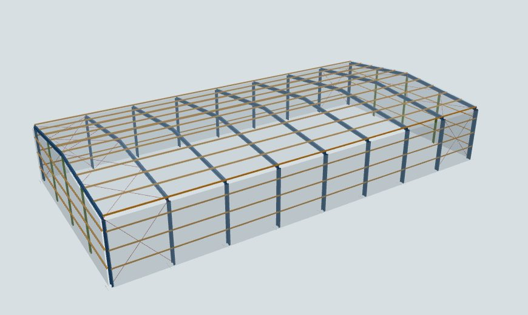
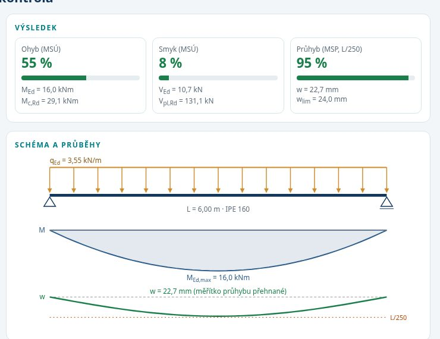
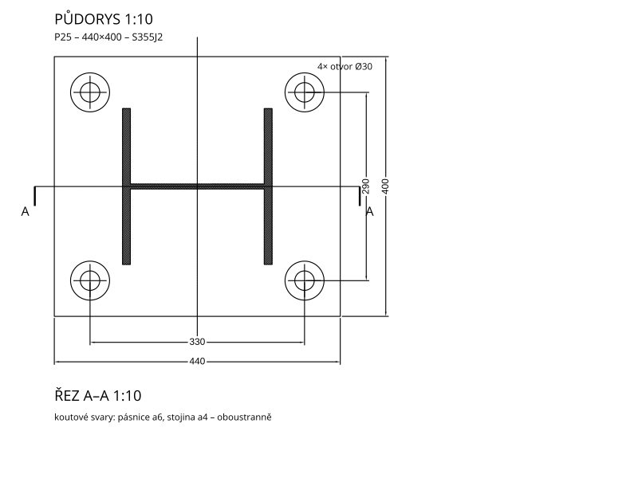
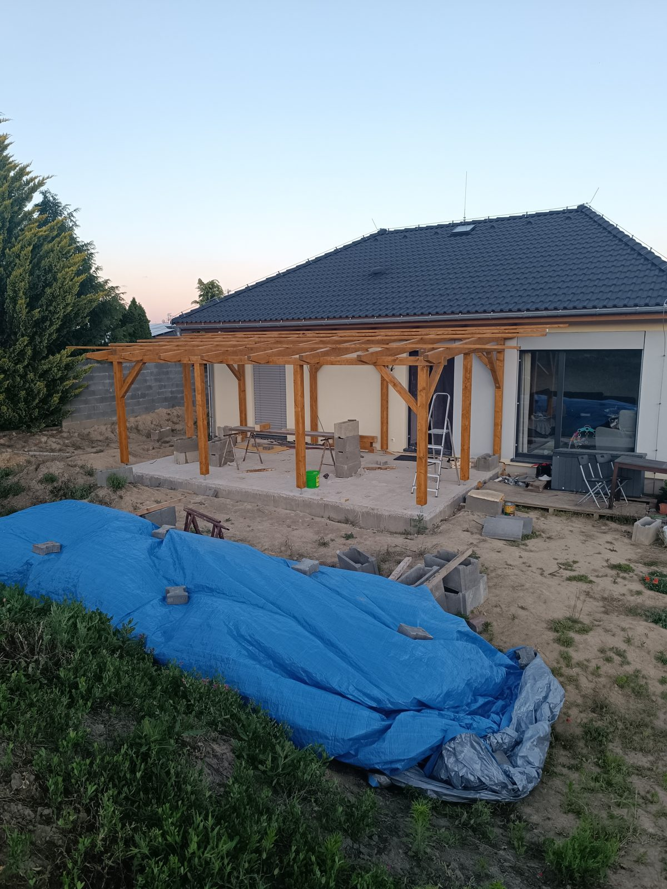
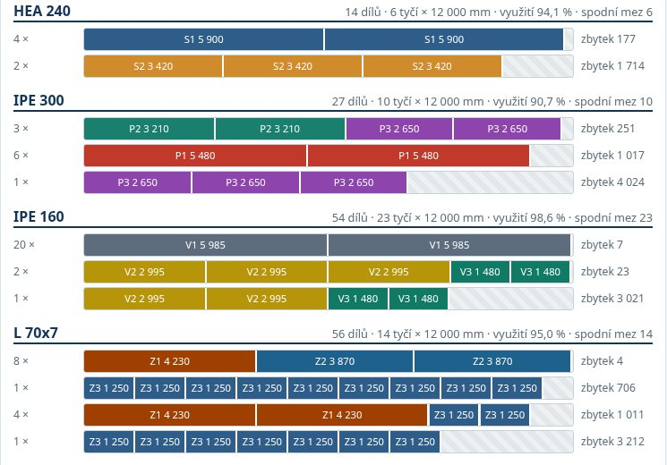
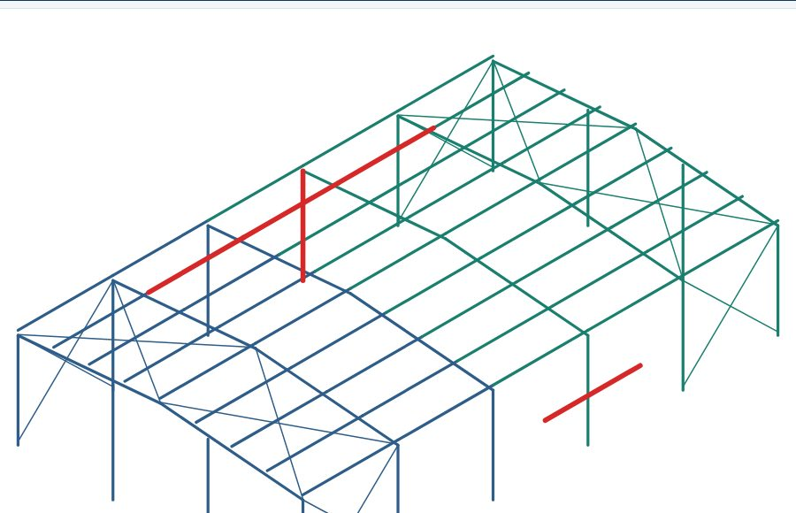
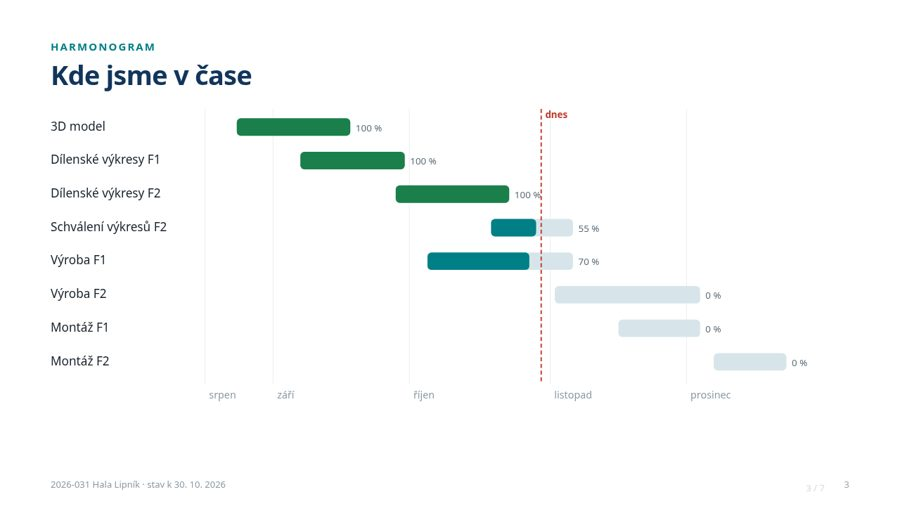

```{=html}
<div class="demo-intro"><span class="eyebrow">GALERIE UKÁZEK / CLAUDE PRO STAVAŘE</span><h1>Od „šlo by…“<br>k funkčnímu nástroji.</h1><p>Všechno vzniklo tak, že jsme Claudovi popsali, co chceme. U každé ukázky najdete zadání a co zkontrolovat.</p></div>
```

```{=html}
<div class="demo-nav"><a href="#konstrukce">Konstrukce a výpočty</a><a href="#vyroba">Výroba a data</a><a href="#klient">Pro klienta</a></div>
```

## Konstrukce a výpočty {#konstrukce}

```{=html}
<div class="demo-grid">
<a class="demo-card" href="ukazky/hala.html"><div class="visual"><span class="number">01</span></div><div class="copy"><span class="demo-kicker">3D v prohlížeči · parametry → konstrukce</span><h3>Ocelová hala z posuvníků</h3><p>Posunete rozpětí nebo sklon a hala se překreslí i s tabulkou hmotností.</p><span class="action">Otočit halu ↗</span></div></a>
<a class="demo-card" href="ukazky/nosnik.html"><div class="visual"><span class="number">02</span></div><div class="copy"><span class="demo-kicker">Kalkulačka · vzorce → webová stránka</span><h3>Rychlá kontrola vaznice</h3><p>Ohyb, smyk a průhyb s mezivýpočty k ruční kontrole. Pomůcka, ne posudek.</p><span class="action">Vyzkoušet výpočet ↗</span></div></a>
<a class="demo-card" href="ukazky/patka.html"><div class="visual"><span class="number">03</span></div><div class="copy"><span class="demo-kicker">DXF · parametry → výkres</span><h3>Patní deska jako DXF</h3><p>Půdorys, řez, kóty a razítko ze skriptu. Otevřete v AutoCADu nebo jiném CADu.</p><span class="action">Prohlédnout výkres ↗</span></div></a>
<a class="demo-card" href="ukazky/pergola.html"><div class="visual"><span class="number">04</span></div><div class="copy"><span class="demo-kicker">Návrh → skutečná stavba</span><h3>Pergola, která opravdu stojí</h3><p>3D návrh, seznam řeziva a spotřeba barvy. Autor workshopu ji podle podkladů postavil.</p><span class="action">Porovnat návrh a stavbu ↗</span></div></a>
</div>
```

## Výroba a data z modelu {#vyroba}

```{=html}
<div class="demo-grid">
<a class="demo-card" href="ukazky/narezy.html"><div class="visual"><span class="number">05</span></div><div class="copy"><span class="demo-kicker">Výroba · kusovník → nářezový plán</span><h3>Dělení 12m tyčí</h3><p>Ze seznamu dílů nářezový plán s prořezem, využitím materiálu a použitelnými zbytky.</p><span class="action">Spočítat nářezy ↗</span></div></a>
<a class="demo-card" href="ukazky/ifc.html"><div class="visual"><span class="number">06</span></div><div class="copy"><span class="demo-kicker">IFC · model → kontrolní report</span><h3>Kontrola IFC před odesláním</h3><p>Množství, hmotnosti podle fází a prvky bez fáze nebo s jinou ocelí, vyznačené v náhledu.</p><span class="action">Otevřít report ↗</span></div></a>
</div>
```

## Pro klienta a kancelář {#klient}

```{=html}
<div class="demo-grid">
<a class="demo-card" href="ukazky/stav-zakazky.html"><div class="visual slides"><span class="number">07</span></div><div class="copy"><span class="demo-kicker">Prezentace · data → kontrolní den</span><h3>Stav zakázky pro klienta</h3><p>Harmonogram, tonáž, výkresy a dotazy na sedmi slajdech z jedné tabulky dat.</p><span class="action">Pustit prezentaci ↗</span></div></a>
</div>
```

::: {.demo-banner}
**Nic z toho není statický výpočet, jen první návrh.** Jeden případ přepočítejte ručně
nebo porovnejte s Teklou. Jak úkol zadat: [Praktické informace](prakticke.qmd).
:::
