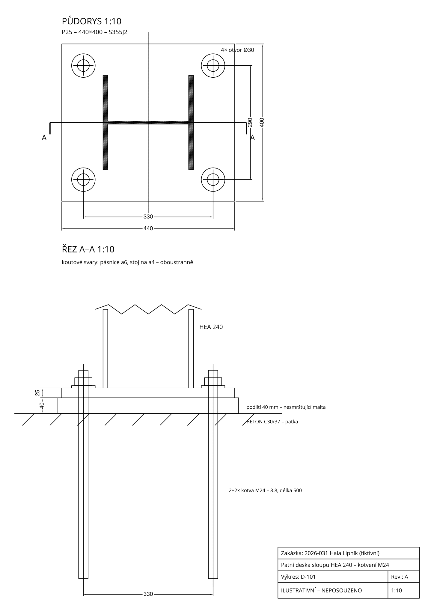

[← Všechny ukázky](../ukazky.qmd){.demo-back}

::: {.demo-summary}
Claude napsal krátký Python skript (knihovna `ezdxf`), který z několika čísel nakreslí
patní desku sloupu HEA 240: půdorys, řez, kotvy, podlití, kóty a razítko. Výsledkem je
DXF s pojmenovanými hladinami, který otevřete v AutoCADu, BricsCADu nebo jiném CAD programu,
a SVG náhled pro web. Když změníte rozměry v hlavičce skriptu, výkres se překreslí.
:::

<div class="demo-steps"><div><small>01 / ZADÁNÍ</small><p>Profil sloupu, rozměry desky, kotvy, podlití.</p></div><div><small>02 / PRÁCE AGENTA</small><p>Skript v Pythonu, spuštění přes uv, kontrola náhledu.</p></div><div><small>03 / VÝSLEDEK</small><p>DXF výkres + SVG náhled + skript.</p></div></div>

{width=100% fig-alt="Výkres patní desky: půdorys desky 440 × 400 s profilem HEA 240 a čtyřmi otvory pro kotvy, řez s podlitím a kotvami, razítko"}

<div class="demo-actions"><a href="../demos/ukazky/patka/patka_HEA240.dxf" download>Stáhnout DXF</a><a href="../demos/ukazky/patka/patka_HEA240.svg" target="_blank" rel="noopener">Otevřít SVG</a><a href="../demos/ukazky/patka/make_patka.py" download>Stáhnout skript</a></div>

## Zadání pro agenta

```default
Napiš Python skript (spouštěj přes uv, knihovna ezdxf), který nakreslí DXF
výkres patní desky sloupu HEA 240: deska 440 × 400 × 25, čtyři kotvy M24
v roztečích 330 × 290, otvory Ø30, podlití 40 mm. Nakresli půdorys s osami
a profilem sloupu a řez A–A s deskou, podlitím, kotvami, maticemi a podložkami.
Okótuj hlavní rozměry a rozteče. Hladiny: DESKA, SLOUP, OSY, OTVORY, KOTVY,
BETON, KOTY, TEXT, RAZITKO. Vpravo dole razítko se zakázkou a číslem výkresu
a textem „ILUSTRATIVNÍ – NEPOSOUZENO“. Všechny rozměry dej jako parametry
nahoru do skriptu. Nakonec vyexportuj SVG náhled a podívej se na něj,
jestli se nic nepřekrývá.
```

Při první verzi zasahoval řez do půdorysu a text v razítku přetékal přes čáru.
Agent obojí sám uviděl v náhledu a po pokynu „oprav překryvy“ to spravil.

## Co si ohlídat

- **Detail nikdo neposoudil.** Tloušťku desky, kotvy a svary navrhuje statik.
  Skript jen kreslí to, co mu zadáte.
- **Rozměry ověřte v CADu.** Odměřte rozteče kotev a vzdálenost od okraje. Zkontrolujte
  i to, že výkres je v milimetrech a měřítku 1 : 1 v modelovém prostoru.
- **Hladiny a styly** odpovídají vašim firemním standardům jen tehdy, když je agentovi
  popíšete. Nejlépe mu dejte vzorový DXF.
- **K čemu je to dobré:** opakované typové detaily (patky, kotevní plány, štítky, šablony),
  kde se mění jen pár čísel. Tekla to pro modelované části umí sama, tohle se hodí na věci
  mimo model nebo pro dodavatele, kteří Teklu nemají.
